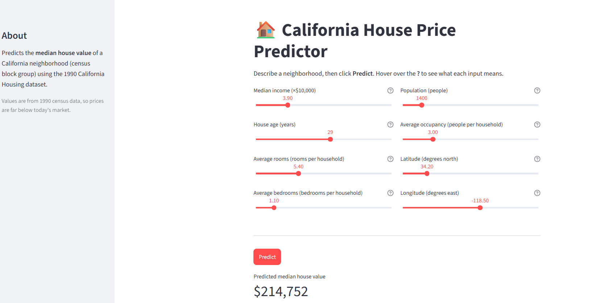
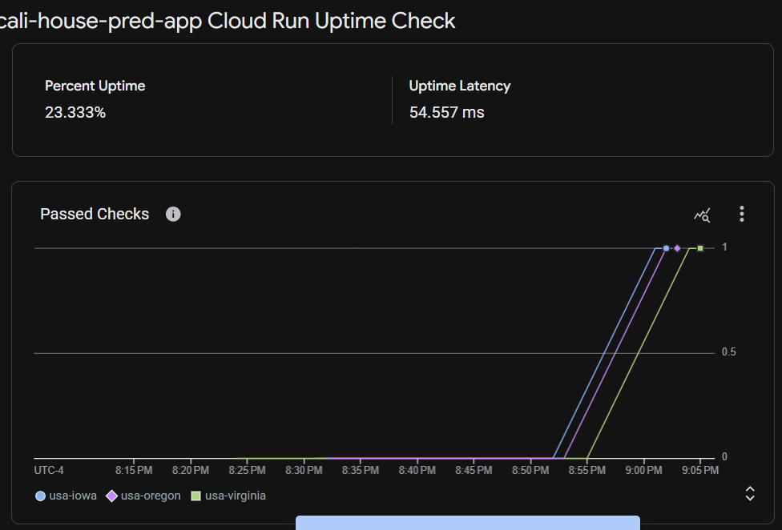
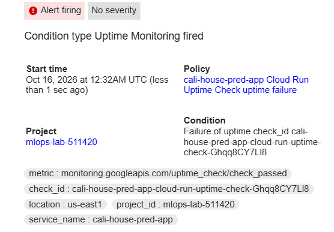

## Watch the tutorial video at [Toturial Video](https://www.youtube.com/watch?v=O0X6NoQyEf0)

Install the [google cloud CLI](https://cloud.google.com/sdk/docs/install) based on your operating system and make sure the gcloud command works 


```
gcloud init
```
Make sure you have authenticated with the correct email Id and selected the correct project id and region
```
gcloud auth login
```

Also make sure you have enabled the folllowing API's
1. Artifact Registry - 
    1.1 Create a repo named gcr.io
2. Cloud build

In your GCP command line run:
```
gcloud services enable cloudbuild.googleapis.com

```

To dockerize the application run
Cloud Build takes the directory you are currently in (or the path you specify) and looks for a Dockerfile or other build instructions to create a Docker container.

```
gcloud builds submit --tag gcr.io/[YOUR_PROJ_ID]/iris-app
```  


Deploying container to Cloud Run service - You will need to first enable cloudRun if this is the first time you are using it.

```
gcloud run deploy iris-app --image gcr.io/[YOUR_PROJ_ID]/iris-app --platform managed --port 8501 --allow-unauthenticated   
```

Once the application is deployed you can update the deployed URL in your frontend source code (streamlit_app.py). then run 

```
streamlit run streamlit_app.py
```

## Changes log

Screenshots of the changes are in the [images/](images/) folder:
- `dashboard.png`: the California House Price Predictor dashboard
- `uptime_check.png`: the Cloud Monitoring uptime check for the Cloud Run service
- `alert.png`: the alert

### Model, dataset and dashboard (Iris -> California Housing)
The lab's original Iris classifier was replaced with a California house price predictor.
- **Dataset:** replaced `src/data/IRIS.csv` (150 rows) with `src/data/california_housing.csv` (20,640 districts, 8 features, target `MedHouseVal` in units of $100,000). It is generated by `src/scripts/csv_extract.py` from scikit-learn's `fetch_california_housing`.
- **Model:** `src/train.py` now trains a `HistGradientBoostingRegressor` (regression) instead of a `RandomForestClassifier` (classification). It uses an 80/20 train/test split and prints R2 and mean absolute error. The model is saved to `model/model.pkl`.
- **Prediction code:** `src/predict.py` takes the 8 features (`med_inc`, `house_age`, `ave_rooms`, `ave_bedrms`, `population`, `ave_occup`, `latitude`, `longitude`) and returns the price in US dollars (model output x 100,000).
- **API:** `POST /predict` in `src/main.py` validates that all 8 fields are present and numeric (400 on error) and returns `{"prediction": <dollars>}`.
- **Dashboard:** `streamlit_app.py` is now the "California House Price Predictor", with sliders (and help tooltips) for each feature and a Predict button that calls the Cloud Run API and shows the predicted median house value. Note the 1990 census data means prices are far below today's market.
- **Tests:** `src/test_api.py` was updated for the new inputs.


### Health check and uptime monitoring
- Added a `GET /health` endpoint in `src/main.py` that returns `{"status": "ok"}` with a 200. It gives Cloud Run and Cloud Monitoring a cheap endpoint to probe.

- Created a Cloud Monitoring **uptime check** for the Cloud Run service `cali-house-pred-app` (us-east1):
  - Protocol HTTPS, port 443, path `/health`, accepts any 2xx response.
  - Authenticates with an OIDC token and runs from 3 US regions (Oregon, Iowa, Virginia).
  - View it under Monitoring -> Uptime checks, or with `gcloud monitoring uptime list-configs`.

- The check first returned 404 because it pointed at `/`, which has no route. Changing the path to `/health` and redeploying fixed it.
- Verify manually: `curl -i https://cali-house-pred-app-434951853629.us-east1.run.app/health`
 

### Other small changes
- `src/main.py`: set `debug=False` so the Flask debugger is not exposed in production.
- `Dockerfile`: base image changed from `python:3.9` to `python:3.11-slim`.
- `.gitignore`: added `venv/`.

### Redeploying after a code change
Cloud Run serves the image you built, so rebuild and redeploy after editing code:
```
gcloud builds submit --tag gcr.io/[YOUR_PROJ_ID]/cali-house-pred-app
gcloud run deploy cali-house-pred-app --image gcr.io/[YOUR_PROJ_ID]/cali-house-pred-app --region us-east1 --platform managed --port 8080 --allow-unauthenticated
```

